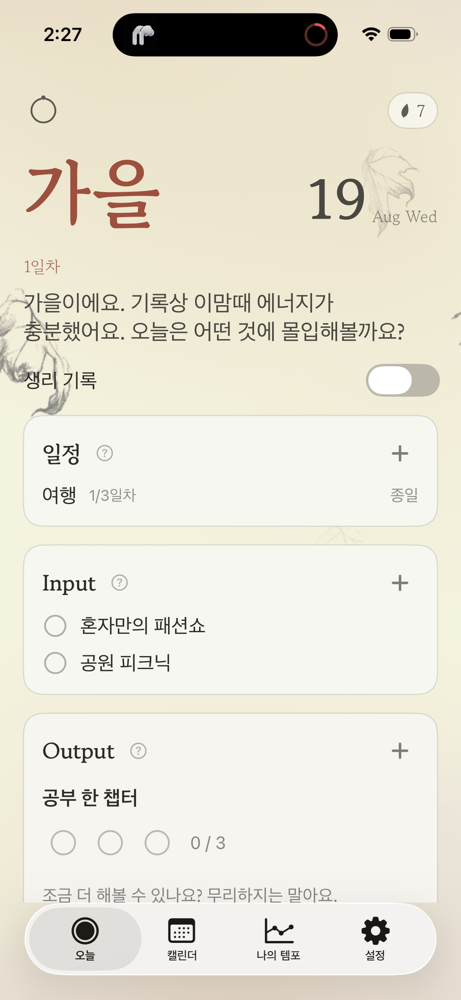
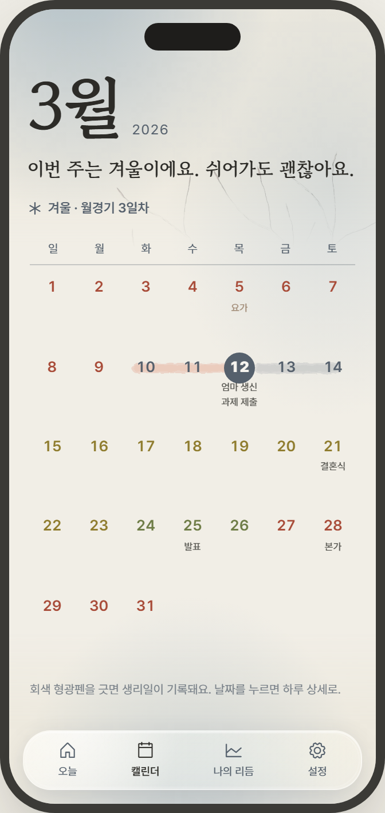
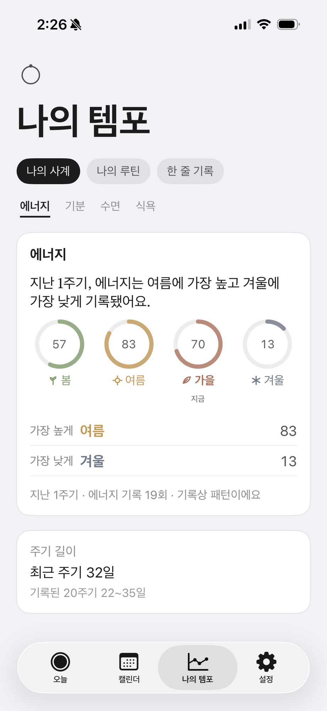

# 템포루틴 TempoRoutine

여성 호르몬 주기를 네 계절로 풀어 하루를 계획하게 하는 iOS 앱. 태그라인 "당신 몸의 템포에 맞게."

주기를 겨울·봄·여름·가을로 바꿔 보여주고, 오늘의 계절에 맞는 강도로 루틴을 잡게 돕는다. 평균값 대신 본인 기록에서 패턴을 찾고, 단정 대신 관찰한 사실만 말한다.

<p>
  
  
  
</p>

- App Store: https://apps.apple.com/kr/app/id6791803620 (1.0.3, 한국)

## 어떻게 쓰나

1. **오늘**: 계절 헤더와 오늘에 맞는 안내, 일정, Input(컨디션 케어 체크), Output(몰입 목표 진행). 타이머·스톱워치 Output은 잠금화면 Live Activity로 이어진다.
2. **캘린더**: 날짜 아래 계절 밑줄 띠, 형광펜을 긋듯 하는 생리 기록, 여러 날 일정 띠, 하루 상세, 공휴일.
3. **나의 템포**: 계절별 에너지·기분·수면·식욕 링 통계, 주기 길이 요약, 한 줄 기록.
4. **예측**: TempoCore 예측 엔진(이상 주기 필터 + 최근 주기 이동 윈도)이 계절 전환일을 계산한다. 아침 브리핑과 전환 예측 알림 3종(기본 켬, 끌 수 있음).
5. **위젯**: 홈·잠금화면 6표면, 앱 테마를 따른다.
6. **기기 간 동기화**: CloudKit(CKSyncEngine) 레코드 미러로 iPhone과 iPad를 맞춘다.
7. **테마**: 체크인으로 모으는 씨앗으로 잠금 해제하는 테마.

## 프라이버시

- 무계정, 자체 서버 없음, 원격 텔레메트리 없음.
- 생리·컨디션 데이터는 기기(SwiftData)와 사용자 개인 iCloud(CloudKit private DB)에만 저장한다.
- Apple 건강 앱(HealthKit) 연동은 선택이다.

## 만든 방법

| 영역 | 도구 |
|---|---|
| 앱 | Swift, SwiftUI, SwiftData, XcodeGen |
| 예측 엔진 | TempoCore, 순수 Foundation SPM 패키지(SwiftData 의존 없음) + 테스트 |
| CI | GitHub Actions 잡 3개: TempoCore 테스트(Linux), 앱 빌드(macOS), TestFlight 업로드 |
| 화면 확인 | CI가 시뮬레이터 스크린샷을 찍어 push마다 아티팩트로 남긴다 |
| Android | Kotlin, Jetpack Compose. TempoCore를 1:1 이식한 `tempocore`와 골든 픽스처 대조 테스트. 이식 진행 중 |

Windows에서 개발한다. 로컬에 Swift 컴파일 환경이 없어 검증 루프는 push 기반이다.

1. push하면 CI가 TempoCore 테스트(Linux 공식 Swift 컨테이너)와 앱 컴파일(macOS 러너, 무서명 아카이브)을 검증한다.
2. 배포할 때만 TestFlight 잡을 수동 디스패치한다. App Store Connect cloud signing으로 서명해 업로드한다.
3. SwiftData 스키마·권한 같은 런타임 동작은 TestFlight 실기기에서 최종 확인한다.

앱은 한국어·영어·일본어·중국어(간체)를 지원한다.

## 폴더

```
App/           SwiftUI 앱 타깃 (SwiftData 모델·화면·온보딩·동기화·알림)
Widgets/       위젯 익스텐션 (홈·잠금화면 6표면 + Live Activity)
Shared/        앱·위젯 공용 (App Group 스냅샷, 인텐트 브리지)
TempoCore/     순수 Foundation SPM 패키지: 예측 엔진·주기 값 타입
  Sources/TempoCore/
    CycleTypes.swift        CyclePhase·CycleAnchor(+커스텀 Codable)·CycleRecurrence 등
    CyclePredictor.swift    averageLength·phaseSpans·resolveDate(+overflow)·cycleDay·confidence
  Tests/TempoCoreTests/
Playground/    Step1 검증용 단일 파일 (역사 보존, SSOT는 TempoCore)
project.yml    XcodeGen 프로젝트 정의
android/       Android 앱 (Gradle 멀티모듈)
  tempocore/   TempoCore의 Kotlin 1:1 이식 (순수 JVM, Android 의존 0) + 동일 테스트 + 골든 픽스처
  app/         Jetpack Compose 앱 (minSdk 31)
.github/workflows/ci.yml       잡 3개: TempoCore 테스트(Linux) · 앱 빌드(macOS) · TestFlight 업로드
.github/workflows/android.yml  tempocore 테스트 + 앱 assembleDebug (Linux, android/** 변경에만)
```

설계 SSOT는 로컬 `MASTER.md`(repo 외부), UI 시안 SSOT는 `ui-mockup/DESIGN.md`(repo 외부).

## 테스트

```bash
swift test --package-path TempoCore
```

Android (JDK 17 + Android SDK 필요):

```bash
cd android && ./gradlew :tempocore:test :app:assembleDebug
```

## 사람

기획, 설계, 개발, 출시까지 한 사람이 만들었다.
